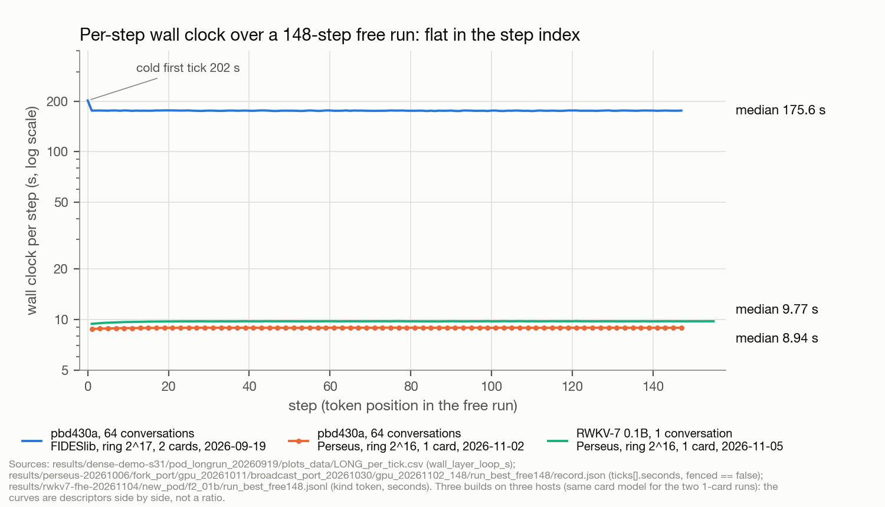
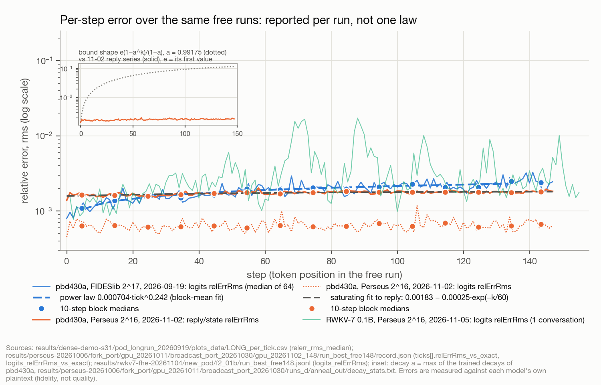
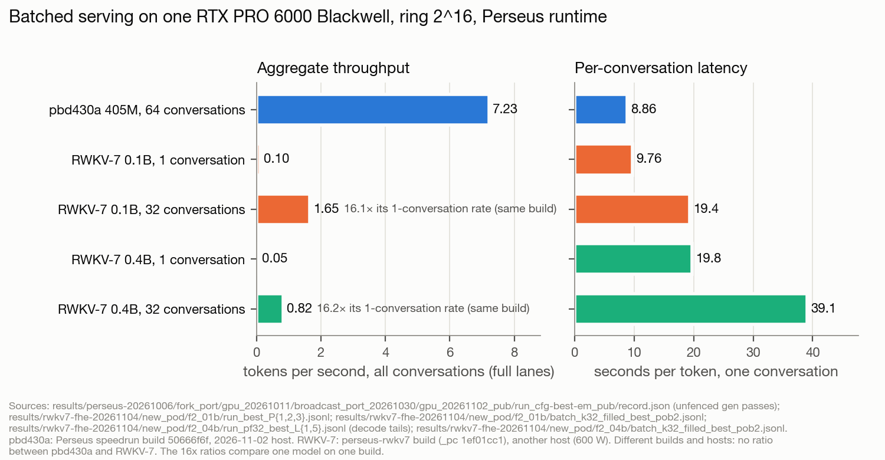
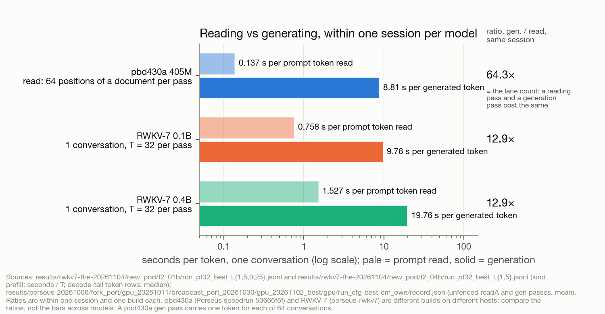
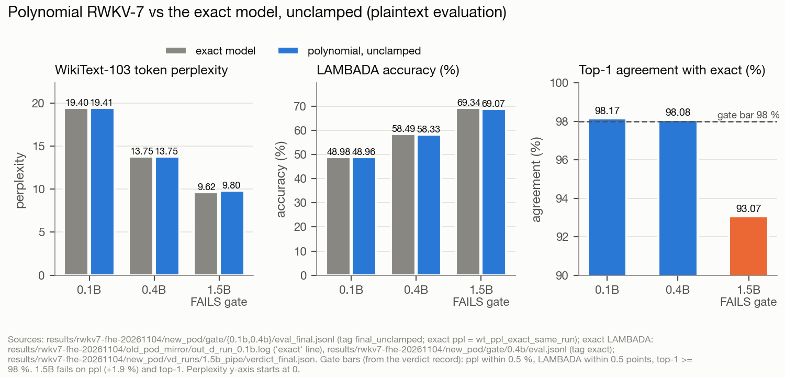
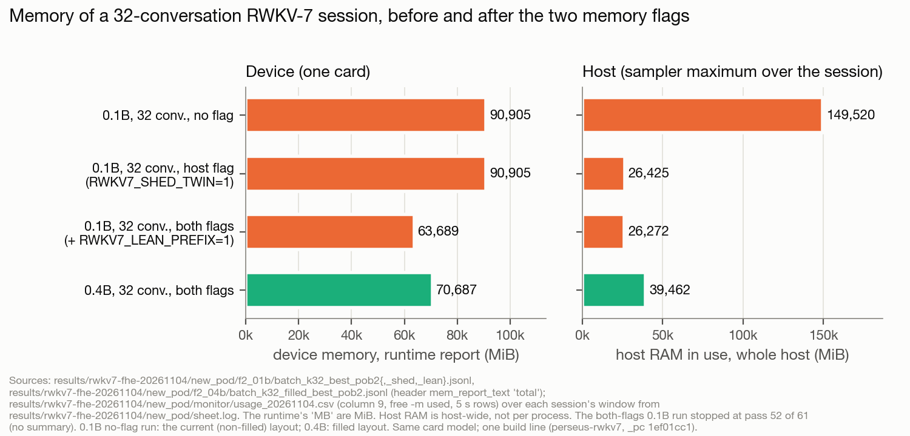

# fhe-ssm

**Recurrent language models that generate text under fully homomorphic encryption: 64 conversations per pass on one GPU,
at a cost and a memory footprint per step that do not grow with the conversation.**

**Project page, with the run's figures: [xelananv.github.io/fhe-ssm](https://xelananv.github.io/fhe-ssm/). Demo video, 3½ minutes: [youtu.be/RypXQfcqSno](https://youtu.be/RypXQfcqSno).**

In this protocol the server holds every conversation's recurrent state encrypted under CKKS, refreshes it every step and sees no token,
logit or activation; the client decrypts each reply and picks the next token. This repository runs two model families
this way on one NVIDIA RTX PRO 6000 Blackwell, at ring 2^16 on the Perseus runtime ([arXiv 2611.04488](https://arxiv.org/abs/2611.04488)),
with a key set the lattice estimator prices at 2^131.28 (classical):

- **A 405M-parameter recurrent model trained for the circuit.** Every nonlinearity is a low-degree polynomial with trained
  coefficients, so the encrypted evaluation computes the model's own arithmetic. 64 conversations advance one token per
  8.86 s pass: 7.2 tokens/s aggregate. A pass can also read 64 positions of one document.
- **RWKV-7 World 0.1B and 0.4B**, the public checkpoints with every non-polynomial operation replaced by a fitted polynomial,
  quality-neutral by a whole-test-set gate. 32 conversations per pass: 1.65 and 0.82 tokens/s aggregate.

Both families ran 148 free-running steps at a constant cost per step. The project's first run (2026-09-19, FIDESlib runtime,
ring 2^17, two cards) is kept below as the earlier result under its own labels: timings from different builds stand side by
side and are never divided into each other. Every number on this page is transcribed from a record in this repository, and
the record is linked beside it.

## In numbers

### November 2026: Perseus runtime, ring 2^16, 1× RTX PRO 6000 Blackwell Workstation (600 W)

| | | record |
|---|---|---|
| **7.2 tokens/s aggregate, 405M model, 64 conversations** | each pass advances 64 conversations by one token; the 16 generation passes of the publication run took **8.857 s** on average (unfenced), so 64 / 8.857 = 7.23 tok/s and 8.86 s per token per conversation | [publication run][pub] |
| **Reading 64 positions per pass** | the same run read document A at 64 positions of the one document per pass: 8.793 s mean over its 8 unfenced reading passes | [publication run][pub] |
| **Fidelity, no secret in the server session** | top-1 agreement with the exact model 1.0 on 56 timed passes and 0.984375 (63 of 64) on two; the session recorded `has_secret: false` | [publication run][pub] |
| **148 free-running steps, 405M model** | unfenced mean **8.929 s** per step (8.793–8.951, 74 steps); one device-memory value over the whole run; raw top-1 9,462 / 9,472, the 10 differences all at plaintext top-two margins ≤ 0.0067; median logit relErrRms per 10-step block 0.00059–0.00069 with no trend; reply relErrRms 0.00163 (first ten steps) → 0.00182 (last ten), a rise to a plateau. In-process keys; the 64 prompts pre-screened as in the first run | [148-step run][f148], [per-block table](docs/RESULTS.md) |
| **RWKV-7 0.1B** | decode **9.74–9.76 s** per token, 141 / 141 top-1 against the polynomial model; prefill **0.76 s** per prompt token, 12.9× its decode; 32 conversations **19.36 s** per pass = 1.65 tok/s at 32 active lanes (1.11 realised as conversations finish), 1,300 / 1,306; 148 free-running steps 155 / 155 at 9.68–9.77 s per token | [f2_01b/][f01] |
| **RWKV-7 0.4B** | decode 19.74–19.77 s; prefill 1.53–1.54 s per prompt token (12.9×); 32 conversations **39.08 s** per pass = 0.82 tok/s (0.55 realised), 1,302 / 1,306; each conversation waits 39.08 s per token | [f2_04b/][f04] |
| **The polynomial RWKV-7 is quality-neutral by the gate** | WikiText-103 token perplexity 19.4144 vs 19.4044 exact (0.1B) and 13.7484 vs 13.7530 (0.4B); LAMBADA 48.96 vs 48.98 % and 58.33 vs 58.49 %; top-1 against exact 98.17 % and 98.08 %; unclamped equals clamped; 286,849 + 413,810 scanned tokens, 0 non-finite. The 1.5B fails (9.800 vs 9.618, top-1 93.07 %) and was not run encrypted | [gate][gate], [1.5B verdict][v15] |
| **Memory of a 32-conversation session** | RWKV-7 0.1B: host 149,520 → 26,425 MiB and device 90,905 → 63,689 MiB with two flags that leave the compiled programs unchanged; 0.4B: 70,687 MiB device, 39,462 MiB host | [shed][shed], [lean][lean], [0.4B][b04] |
| **Continuous batching on the device** | conversations join a free lane after their prefill and leave when done: 8 conversations at K = 4 (0.1B, 245 / 248) and K = 8 (0.4B, 247 / 248), a join 3–5 ms; in-process keys; 0.4B at K = 32 ran out of device memory at CUDA graph instantiation | [K = 4][s4], [K = 8][s8] |
| **Key set** | main key 2^131.28, weight-32 encapsulation key 2^142.97, PCMM ring-switch key 2^159.71 (lattice estimator, classical, IND-CPA) | [battery][est] |

**Where the secret was.** In every November run the client role ran on the GPU machine. The 405M publication run and the
RWKV-7 runs in `f2_01b/` and `f2_04b/` (except the serve loops) opened a server session without the secret; RWKV-7's client
object in the same process encrypted the inputs, while for the 405M model the session encrypted them with the public key.
The other November runs held the secret in the session. Only the 2026-09-18 session kept the secret on another machine
([docs/SECURITY.md](docs/SECURITY.md)).

*Wall clock per step of the 148-step free runs; each line names its build, and no ratio is taken across them.*

*Relative rms error per step of the same runs, reported per run and labelled by build.*

*Aggregate tokens/s and seconds per token per conversation, November runs (one card class, one runtime).*

*Seconds per prompt token read against per generated token, inside one session per model.*

*Polynomial RWKV-7, unclamped, against the exact model (plaintext evaluation).*

*Device and host memory of a 32-conversation RWKV-7 session, without and with the two memory flags.*

### The first run, September 2026: FIDESlib runtime, ring 2^17, 2× RTX PRO 6000 Blackwell 96 GB

| | | record |
|---|---|---|
| **175.6 s per 64-token step** | layer loop (188 s request to reply), the same at step 1 and at step 148: 2.7 s per generated token in aggregate, while each conversation waits 175.6 s per token | [LONG_REPORT.md §1](results/dense-demo-s31/pod_longrun_20260919/LONG_REPORT.md) |
| **8 h 04 min, 148 steps, 9,472 tokens, 0 failures** | free-running: every step fed each conversation the token the encrypted session had just produced | [LONG_REPORT.md §3](results/dense-demo-s31/pod_longrun_20260919/LONG_REPORT.md) |
| **Constant memory, 529 bootstraps every warm step** | 48 carried ciphertexts, no KV cache; device pool identical after each of 147 requests on both cards | [LONG_REPORT.md §2](results/dense-demo-s31/pod_longrun_20260919/LONG_REPORT.md), [server.jsonl](results/dense-demo-s31/pod_longrun_20260919/pod_pull/s37/serve_LONG/logs/server.jsonl) |
| **99.7 % top-1 fidelity** | 9,445 / 9,472, the 27 differences all near-ties (plaintext top two within 0.03 logits); block-mean logit relErrRms 0.001045 → 0.002540, still rising at the end. Conditional on 64 pre-screened prompts ([how they were chosen](docs/RESULTS.md)) | [FIDELITY_TREND.md](results/dense-demo-s31/pod_longrun_20260919/FIDELITY_TREND.md) |
| **A recorded client-keyed session, replayable** | 64 prompts, 492 tokens, keys generated on a laptop, every ciphertext that crossed the wire kept; re-decrypting the kit reproduces all 492 tokens | [docs/VERIFICATION_KIT.md](docs/VERIFICATION_KIT.md) |
| **Bootstrap overflow, measured** | 17 of 71,236 non-trivial bootstraps exceeded the stock range (17.97 expected); each such step decoded | [RECORDER_EVENTS.md](results/dense-demo-s31/pod_longrun_20260919/RECORDER_EVENTS.md) |

The long session used server-generated test keys (its flight recorder reads the secret); the 2026-09-18 session is the
privacy demonstration. Ring 2^17, OpenFHE `HEStd_128_classic`, uniform ternary secret ([docs/SECURITY.md](docs/SECURITY.md)).

**The 405M model's quality:** 404,715,520 parameters, WikiText-103 token perplexity 28.55, LAMBADA 9 % ([docs/RESULTS.md](docs/RESULTS.md) §4).
Fidelity says the circuit computes what the model computes; it does not make the model good.

**GPU-seconds per generated token.** The first run spent 5.5–5.9 (two cards × 175.6–188 s ÷ 64); Perseus's GPT-2 small spends
1.9 at batch 1, ahead raw and level per parameter. The November 405M figure, 8.857 s ÷ 64 = 0.138, is about 2.5–2.8× Perseus's
Llama-3-8B row (7.8 s) per parameter and slower per conversation (8.86 s against 7.8 s). Batched aggregate and single-stream
figures are different quantities ([docs/COMPARISON.md](docs/COMPARISON.md)).

## How it works

1. **A recurrence, not attention.** Each block carries a fixed set of encrypted vectors whatever the context length (405M:
   the scan state and one token of shift history; RWKV-7: its matrix-valued state and two shift vectors). No KV cache.
2. **The model is the circuit (405M only).** Cubic and quadratic gates with trained coefficients and a Newton inverse square
   root: the circuit adds only the scheme's arithmetic error (CKKS noise, and on the Perseus path the 24-bit PCMM weights),
   measured every step against the plaintext model on the same tokens.
3. **Polynomial RWKV-7.** Every tanh, sigmoid, decay, ReLU² and inverse square root of the public checkpoint is a fitted
   Chebyshev polynomial or a Newton iteration on a fixed interval. A ciphertext cannot be clamped, so a gate scores the
   polynomial model unclamped over whole test sets before anything runs encrypted.
4. **Canonical carry and planned refreshes.** Every carried ciphertext returns to the same level and scale each step, so
   every step is the identical circuit. A planner places the bootstraps on a captured graph of one step; the compiled
   program is replayed every step.
5. **PCMM linears.** Weight matrices are 24-bit plaintext matrices in a plaintext–ciphertext matrix product with a
   correction-factor finish: relErrRms 2–5e-3 against 1–2e-4 for rotated diagonals, at less than half the pass time.
6. **Lanes and the filled layout.** Two real values share each complex slot: 64 conversations × 1,024 channels fill a ring-2^16
   ciphertext, and one bootstrap refreshes all 64. RWKV-7's batched runs pack the carried state's two value groups the same way.
7. **Prefill through the decode lanes.** A prompt is read T = 32 tokens per pass (RWKV-7) or 64 positions per pass (405M) in
   the lanes that otherwise hold conversations.
8. **A serve loop.** Conversations join a free lane after their prefill (a register hand-over and one small program) and leave
   when they finish.
9. **The client picks the tokens.** It decrypts the reply, applies the output head in plaintext (for RWKV-7 also the final
   LayerNorm `ln_out`), picks the next token and feeds it back. No path evaluates the head or the argmax under encryption.

The first run's library fixes (a FIDESlib key-switching leak, an extended bootstrap range, OpenFHE
[#1264](https://github.com/openfheorg/openfhe-development/issues/1264)) and the equations, packing, levels and protocol of
both runtimes are in [docs/ARCHITECTURE.md](docs/ARCHITECTURE.md).

## What it is not

- **Not fast for one conversation.** 8.86 s per token per conversation in the 405M batch, 9.74 s for RWKV-7 0.1B alone;
  Perseus reports 1.9 s (GPT-2 small) and 7.8 s (Llama-3-8B) single-stream on the same card class.
  The lanes are throughput, not latency.
- **Not a good model (405M).** WikiText-103 28.55, LAMBADA 9 %.
- **Not a deployment with the secret elsewhere, in November.** The client role ran on the GPU machine in every November run;
  only the 2026-09-18 session kept the secret on another machine.
- **Not a guarantee for every prompt (RWKV-7).** Scanned unclamped over 700,659 tokens of corpus text, neither model produced a non-finite value, and four tokens in all
  fell below one site kind's accuracy interval, inside its convergence region; an adversarial prompt
  is not excluded, and an earlier, narrower fit broke all 32 conversations of a batched run from one conversation's own
  generated text.
- **Not an error law.** Each error trend comes from one run per build.
- **Not shown to scale.** The RWKV-7 1.5B fails the gate; "the model is the circuit" holds for the 405M model only.
- **Not private for the weights.** The server holds the model in plaintext. More: [docs/LIMITATIONS.md](docs/LIMITATIONS.md).

## The model, the keys, the ciphertexts

- 405M weights, bundle, config, training log: **[huggingface.co/xelananv/fhe-ssm-pbd430a](https://huggingface.co/xelananv/fhe-ssm-pbd430a)**.
- RWKV-7: the public `RWKV-x070-World-0.1B-v2.8` and `-0.4B-v2.9` checkpoints; the fitted coefficients are
  [gate/0.1b/coeffs_final.json](results/rwkv7-fhe-20261104/new_pod/gate/0.1b/coeffs_final.json) and
  [gate/0.4b/coeffs_final.json](results/rwkv7-fhe-20261104/new_pod/gate/0.4b/coeffs_final.json).
- The verification kit of the 2026-09-18 session (its keys, every request and reply ciphertext) and the 51 GB of evaluation
  keys: **[huggingface.co/datasets/xelananv/fhe-ssm-verification-kit](https://huggingface.co/datasets/xelananv/fhe-ssm-verification-kit)**;
  what it lets anyone check: [docs/VERIFICATION_KIT.md](docs/VERIFICATION_KIT.md).

## Layout

The directory names are the working tree's own, so that every path inside the scripts is valid as published.

| directory | contents |
|---|---|
| [ml-eval/](ml-eval/) | the trainer, evaluation, the client driver, a chat server for the plaintext model, the 405M config, seeds and training log |
| [hpc_gpu_port/](hpc_gpu_port/), [harness/](harness/), [spec_decode/](spec_decode/) | the first run's GPU server and client tool, the CPU twin and probes, the free-running driver, the plaintext reference |
| [campaign/scripts/](campaign/scripts/), [provisioning/](provisioning/), [results/dense-demo-s31/](results/dense-demo-s31/) | the first run's builds, patches, scripts, records and reports, the recorded client-keyed session, the training runs |
| [results/perseus-20261006/fork_port/gpu_20261011/broadcast_port_20261030/](results/perseus-20261006/fork_port/gpu_20261011/broadcast_port_20261030/) | the 405M model's November runs on the Perseus runtime: the publication run, the 148-step run, the lever runs |
| [results/rwkv7-fhe-20261104/new_pod/](results/rwkv7-fhe-20261104/new_pod/) | the RWKV-7 runs: decode, prefill, batched, free run, serve loops (`f2_01b/`, `f2_04b/`), the gate (`gate/`), the 1.5B verdict |
| [results/estimator-speedrun-port-20261103/](results/estimator-speedrun-port-20261103/), [estimator/](estimator/) | the lattice-estimator runs of both key sets |
| [figures/](figures/) | the figures on this page, rendered from the records named in their sources file |
| [docs/](docs/) | [ARCHITECTURE](docs/ARCHITECTURE.md) · [RESULTS](docs/RESULTS.md) · [COMPARISON](docs/COMPARISON.md) · [SECURITY](docs/SECURITY.md) · [RUNBOOK](docs/RUNBOOK.md) · [LIMITATIONS](docs/LIMITATIONS.md) · [VERIFICATION_KIT](docs/VERIFICATION_KIT.md) |
| [xelananv/perseus](https://github.com/xelananv/perseus) `fhe-ssm-speedrun` | the 405M port: `python/perseus/examples/fhe_ssm` (model, planned driver, pass kernels), `tools/fhe_ssm` (`run_gpu.sh`, plan scripts) |
| [xelananv/perseus](https://github.com/xelananv/perseus) `fhe-ssm-rwkv7-any` | the RWKV-7 port: `python/perseus/examples/rwkv7` (circuit, prefill, batched, serve), `tools/rwkv7` (`run_box.sh`, `size_pipeline.sh`) |

Paths cited in the code but not released are listed in [docs/NOT_INCLUDED.md](docs/NOT_INCLUDED.md); none is needed to
build, serve, replay or check the released artifacts.

## Running it

**The November path (one card with ≥ 96 GB).** Clone the fork at the branch of the model and follow its README:
`tools/fhe_ssm/run_gpu.sh box build verify`, then `capture`, `plan`, `keyspec`, `keygen` and `run` for an arm (405M), or
`tools/rwkv7/run_box.sh` with `KEYS=bundle` after `keyspec` and `keygen` (RWKV-7). The order and the flags of the recorded
runs are in [docs/RUNBOOK.md](docs/RUNBOOK.md).

**The first run's path.** Two machines: a box with two 96 GB cards and a laptop with the secret key; FIDESlib at the pinned
commit with the patches above, ≈ 180 GB of host RAM, a 68 GB weight store ([docs/RUNBOOK.md](docs/RUNBOOK.md)).

**Without a GPU.** The plaintext model runs on a laptop (`ml-eval/serve_ollama.py`); both ports run on Perseus's numpy fake.

## License and contact

MIT ([LICENSE](LICENSE)). The two ports run on Perseus by Alessandro Zirilli, Davide Marincione and the GLADIA group at
Sapienza ([gladia-research-group/perseus](https://github.com/gladia-research-group/perseus), [arXiv 2611.04488](https://arxiv.org/abs/2611.04488)),
which is under the Business Source License 1.1; any commercial use of the contributed files as part of Perseus requires prior
written permission from Alessandro Zirilli or Davide Marincione under that license, while on their own the files are MIT.
Alexander Ananyev, independent researcher — xelananv@protonmail.com · [xelananv.github.io/fhe-ssm](https://xelananv.github.io/fhe-ssm/) ·
[x.com/xelananv](https://x.com/xelananv) · [github.com/xelananv](https://github.com/xelananv). Cite with [CITATION.cff](CITATION.cff).

[pub]: results/perseus-20261006/fork_port/gpu_20261011/broadcast_port_20261030/gpu_20261102_pub/run_cfg-best-em_pub/record.json
[f148]: results/perseus-20261006/fork_port/gpu_20261011/broadcast_port_20261030/gpu_20261102_148/run_best_free148/record.json
[f01]: results/rwkv7-fhe-20261104/new_pod/f2_01b/
[f04]: results/rwkv7-fhe-20261104/new_pod/f2_04b/
[b04]: results/rwkv7-fhe-20261104/new_pod/f2_04b/batch_k32_filled_best_pob2.jsonl
[gate]: results/rwkv7-fhe-20261104/new_pod/gate/
[v15]: results/rwkv7-fhe-20261104/new_pod/vd_runs/1.5b_pipe/verdict_final.json
[shed]: results/rwkv7-fhe-20261104/new_pod/f2_01b/batch_k32_best_pob2_shed.jsonl
[lean]: results/rwkv7-fhe-20261104/new_pod/f2_01b/batch_k32_best_pob2_lean.jsonl
[s4]: results/rwkv7-fhe-20261104/new_pod/f2_01b/serve_k4_pf32_best_pob2.jsonl
[s8]: results/rwkv7-fhe-20261104/new_pod/f2_04b/serve_k8_pf32_filled_best_pob2.jsonl
[est]: results/estimator-speedrun-port-20261103/battery.txt
